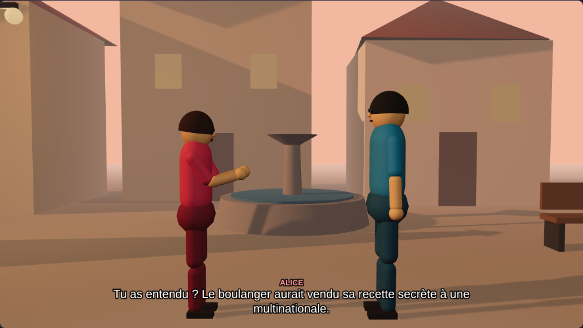

# Studio 3D — du scénario à la séquence

Logiciel web qui transforme un scénario écrit en séquences 3D jouables et exportables : décors, personnages animés, dialogues sous-titrés (et voix de synthèse en aperçu), éclairages, découpage caméra et rendu vidéo.



## Lancer

Ouvre `studio-3d/index.html` dans un navigateur récent (Chrome, Edge, Firefox). Aucun serveur, aucune installation, aucune connexion : Three.js est fourni dans `vendor/`.

## Chaîne de fabrication

```text
texte du scénario
  → parser.js     analyse : titre, personnages, scènes, répliques, actions, directives
  → director.js   réalisation automatique : durées, placements, déplacements, gestes,
                  postures, découpage caméra, éclairages  →  « plan de tournage » (JSON)
  → stage.js      plateau 3D : évalue le plan à l'instant t (décor, animation, lumière,
                  météo, caméra) puis compose l'image (sous-titres, cartons, fondus)
  → app.js        interface : lecture, frise, découpage, voix, exports
```

Le plan de tournage est entièrement déterministe : chaque image ne dépend que de l'instant `t`. On peut donc sauter n'importe où dans la séquence, et l'export reproduit exactement l'aperçu.

## Écrire un scénario

```text
TITRE: La Rumeur du boulanger
PERSONNAGE: ALICE | couleur=#d1495b | taille=1.66 | cheveux=#3b2418 | voix=aigue

SCÈNE 1 — EXT. PLACE DU VILLAGE — AUBE
AMBIANCE: brouillard
ALICE: (inquiète) Tu as entendu ?
[Bruno marche vers Alice.]
CAMÉRA: gros plan BRUNO
BRUNO: (surpris) Encore ?
LUMIÈRE: orage
```

| Élément | Effet |
|---|---|
| `SCÈNE n — INT./EXT. LIEU — MOMENT` | Nouveau décor. Le lieu choisit le décor (place, rue, forêt, salon, café, bureau), INT/EXT et le moment (jour, aube, soir, nuit) choisissent l'éclairage. |
| `NOM: (indication) réplique` | Dialogue. L'indication fixe l'émotion jouée : colère, peur, inquiétude, tristesse, joie, surprise, chuchote, ironie, calme. Le format classique (nom seul sur une ligne, réplique dessous) est aussi accepté. |
| `[action]` | Verbes reconnus : entre, sort, marche/va/rejoint, court, s'assoit, se lève, salue, pointe, hoche la tête, secoue la tête, croise les bras, se retourne, sursaute, rit, pleure, réfléchit, danse, regarde, chuchote. Destinations : un personnage ou un repère du décor (porte, banc, table, fontaine, comptoir, gauche, droite, centre, fond…). |
| `CAMÉRA:` | Impose le cadrage du plan suivant : large, plan moyen, plan à deux, amorce, gros plan, plongée, contre-plongée, travelling. |
| `LUMIÈRE:` | jour, aube, crépuscule, nuit, intérieur, tamisée, néon, orage (avec éclairs). Avant la première ligne de la scène, elle remplace l'éclairage par défaut ; ensuite, elle produit un fondu lumineux. |
| `AMBIANCE:` | pluie, neige, brouillard. |
| `DÉCOR:` | Force un décor. |
| `PAUSE: 2` | Plan muet de 2 s. |

Sans directive, le réalisateur choisit seul : plan d'ensemble à l'ouverture de chaque scène, plan à deux au premier échange, champ/contrechamp en amorce ensuite, gros plan pour les répliques longues, tristes ou chuchotées, contre-plongée pour la colère, travelling pour les déplacements, avec la règle des 180° respectée.

## Exports

- **Vidéo WebM** : enregistrement du rendu (image, sous-titres, cartons) via `MediaRecorder`. L'enregistrement se fait en temps réel.
- **Capture PNG** de l'image courante.
- **Plan de tournage JSON** : tout le découpage, réutilisable dans un autre outil (Blender, moteur de jeu…).

## Limites actuelles

- La voix de synthèse utilise l'API du navigateur : elle sert à l'aperçu, mais elle n'est **pas** enregistrée dans la vidéo exportée, qui est muette.
- Les personnages sont des mannequins stylisés générés par le code, sans import de modèles 3D.
- L'analyse des actions repose sur une liste de verbes : une phrase non reconnue devient un plan d'ambiance, et le panneau « Analyse » l'indique.
- Sur une machine lente, l'export vidéo garde le bon rythme mais peut sauter des images.

## Tests

```bash
node --test studio-3d/tests/*.test.js
```
